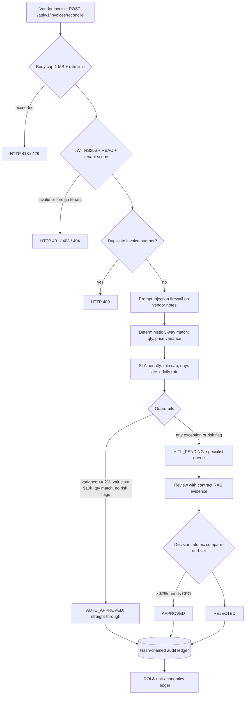

# Autonomous B2B Supply Chain & Procurement Agent

> Deterministic 3-way invoice reconciliation, SLA penalty recovery, a prompt-injection firewall and a tamper-evident audit ledger, wrapped in a human-in-the-loop control tower.

[](https://github.com/samuelhtampubolon/autonomous-b2b-procurement-agent/actions/workflows/ci.yml)
[](https://github.com/samuelhtampubolon/autonomous-b2b-procurement-agent/actions/workflows/codeql.yml)
[](https://www.python.org/)
[](https://fastapi.tiangolo.com/)
[](https://owasp.org/API-Security/editions/2023/en/0x11-t10/)

## Live interactive demo

**[samuelhtampubolon.github.io/autonomous-b2b-procurement-agent](https://samuelhtampubolon.github.io/autonomous-b2b-procurement-agent/)**

A fully client-side showcase (no backend, no data leaves the browser):

| Section | What you can do |
| :--- | :--- |
| 3-way match simulator | 7 scenario presets (clean, price creep, late delivery, high value, qty mismatch, prompt injection, duplicate billing), live routing decision, penalty math, and the exact API request/response/cURL |
| HITL workbench | 50 seeded invoices, filters, sorting, search, CSV export, review drawer with contract evidence; RBAC and the $25k CPO sign-off rule enforced per persona |
| Audit ledger | Live SHA-256 hash chain; simulate insider tampering and watch verification pinpoint the altered entry |
| ROI modeler | Volume, effort, wage, STP rate, lateness, invoice value and platform cost sliders with value-bridge and 12-month charts |
| Contract RAG | TF-IDF cosine search over supplier clauses with term highlighting; injection attempts are neutralized before scoring |
| Security labs | OWASP API Top 10 control matrix, prompt-injection firewall playground, BOLA probe, JWT claims and account-lockout demo |

The browser engine (`docs/assets/js/engine.js`) is a port of the Python rules, and `tests/test_docs_parity.py` runs it under Node to prove it returns the same routing, flags, RAG scores and audit hashes as the backend.

The page itself is hardened: strict Content-Security-Policy (`script-src 'self'`, Trusted Types required, no inline handlers or styles), every dynamic value written with `textContent`, and CSV export protected against spreadsheet formula injection.

---

## 1. Executive summary

Enterprise procurement teams lose money in three places:

1. **3-way matching bottlenecks.** Analysts spend ~18 minutes per invoice cross-checking Purchase Orders, Goods Receipts and vendor invoices, delaying payment and forfeiting early-payment discounts.
2. **Contract leakage.** Vendors bill above contracted prices or deliver late without the contracted SLA penalties being deducted.
3. **Opaque AI economics.** LLM workflows ship without tracking token and platform cost against the labor they actually save.

This agent clears clean invoices straight through in milliseconds with **deterministic arithmetic** (no LLM touches the numbers), deducts SLA penalties automatically, and routes every risky exception (price variance above 2%, value above $10k, quantity mismatch, suspected duplicate billing, or a prompt-injection attempt in vendor text) to a specialist queue. Every action is sealed in a per-tenant hash chain.

On the seeded demo data: **68% straight-through processing**, SLA penalties recovered automatically, 11 exceptions routed to humans, and an intact 55-entry audit chain.

---

## 2. Architecture & BPMN flow



| Component | Implementation |
| :--- | :--- |
| Backend API | FastAPI (`src/api/main.py`, `src/api/routes_procurement.py`): security headers, body cap, Host/CORS allow-lists, rate limits, RBAC |
| Matching engine | `src/services/matching_engine.py`: pure `compute_match()` plus persistence, duplicate and risk screening |
| Audit ledger | `src/services/audit_ledger.py`: SHA-256 chain, append-only ORM guard and SQLite trigger, verification |
| Contract RAG | `src/services/contract_rag.py`: local TF-IDF cosine similarity, zero cloud dependency |
| Unit economics | `src/services/roi_calculator.py`: OpEx savings, SLA recovery, measured latency |
| Security | `src/security.py`: bcrypt, hardened JWT, revocation, lockout, RBAC, BOLA, injection firewall, PII redaction |
| Data | `src/database.py`, `src/models.py`: SQLAlchemy 2.0, SQLite by default, PostgreSQL ready, additive migrations |
| Control tower | `src/ui/dashboard.py`: Streamlit + Plotly, HITL queue, audit ledger view |
| Launcher | `run_local.py`: preflight checks, free-port selection, graceful shutdown |
| Showcase | `docs/`: GitHub Pages site |

Architecture decisions are recorded in [ADR.md](ADR.md).

---

## 3. Unit economics

**Net OpEx savings**

$$\text{Net OpEx} = \frac{M}{60} \cdot W \cdot \left(N_{auto} + 0.7 \cdot N_{hitl}\right) - \left(\frac{T}{1000} \cdot C_{token} + C_{infra}\right)$$

- $M$ = manual minutes per invoice (default 18), $W$ = analyst cost per hour (default $45)
- Straight-through invoices save the full effort; HITL-assisted invoices save 70%
- $T$ = tokens consumed, $C_{token}$ = $0.002 per 1k tokens, $C_{infra}$ = fixed platform cost

**SLA penalty deduction**

$$\text{Penalty} = \text{Subtotal} \cdot \min\left(\text{Cap}_{vendor},\ \text{DaysLate} \cdot \text{Rate}_{daily}\right)$$

**Total commercial benefit** = Net OpEx + SLA penalties recovered; **ROI multiple** = benefit / AI operating cost.

---

## 4. Security architecture (OWASP API Security Top 10, 2023)

| Risk | Control | Test |
| :--- | :--- | :--- |
| API1 BOLA | `get_owned_resource()` scopes every lookup by `id AND tenant_id`; foreign objects return the same 404 as missing ones | `test_owasp_api1_bola_cross_tenant_rejection` |
| API2 Broken authentication | bcrypt cost 12; constant-time login (dummy hash for unknown users); per-account lockout (5 failures / 15 min); HS256 pinned with required `iss`, `aud`, `jti`, `nbf`, `typ`; token revocation via `/auth/logout`; no default signing key | `test_alg_none_and_foreign_key_tokens_rejected`, `test_account_lockout_after_repeated_failures`, `test_logout_revokes_token` |
| API3 Object property authorization | `extra='forbid'` on every request model; explicit `response_model`; validation errors never echo submitted values (no password reflection) | `test_owasp_api3_mass_assignment_extra_fields_rejection`, `test_validation_errors_never_echo_secrets` |
| API4 Resource consumption | slowapi limits (5/min login, 60/min reconcile, 30/min decisions and search); 1 MB body cap that also counts chunked uploads; bounded numbers; pagination capped at 100 | `test_login_rate_limit_per_ip`, `test_request_body_size_limit` |
| API5 Function level authorization | `require_roles()`: `auditor` is read-only, audit ledger restricted to `cpo` and `auditor` | `test_auditor_is_read_only` |
| API6 Sensitive business flows | Duplicate invoice numbers rejected (409, plus a unique index); second invoice on a settled PO flagged; CPO sign-off above $25k; atomic compare-and-set so an invoice can be decided only once; future delivery dates rejected | `test_duplicate_invoice_number_rejected`, `test_high_value_approval_requires_cpo`, `test_decision_is_single_use` |
| API7 SSRF | No server-side URL fetching; fully offline operation | design constraint |
| API8 Security misconfiguration | CSP, `nosniff`, `X-Frame-Options: DENY`, COOP/CORP, `Referrer-Policy`, `Cache-Control: no-store`, request IDs, `Server` header removed, Host allow-list, CORS allow-list, docs disabled in production, generic 500 bodies, non-root read-only container | `test_security_headers_injection`, `test_untrusted_host_header_rejected` |
| API9 Inventory management | Versioned `/api/v1`; OpenAPI hidden in production; Dependabot, pip-audit and CodeQL in CI | CI `security` job |
| API10 Unsafe consumption (LLM) | Prompt-injection firewall: NFKC normalization, zero-width and bidi-override stripping (Trojan Source), 14 rules for instruction override, role spoofing, chat-template tokens, persona/approval override, secret exfiltration and markup. **Any flag forces human review.** PII, card numbers, emails and bearer tokens are redacted from logs | `test_injection_in_vendor_notes_forces_human_review`, `test_injection_rules` |
| Audit integrity | Per-tenant SHA-256 hash chain; ORM append-only guard plus SQLite trigger; `/api/v1/audit/verify` pinpoints the first altered entry | `test_audit_chain_detects_tampering` |

See [SECURITY.md](SECURITY.md) for the threat model, secret handling and how to report a vulnerability.

---

## 5. Quickstart

Requires Python 3.11+.

```bash
git clone https://github.com/samuelhtampubolon/autonomous-b2b-procurement-agent.git
cd autonomous-b2b-procurement-agent
python -m venv .venv
# Windows: .\.venv\Scripts\Activate.ps1    macOS/Linux: source .venv/bin/activate
pip install -r requirements-dev.txt

python run_local.py --check   # schema, seed, /healthz, /readyz, security headers, audit chain
python run_local.py           # FastAPI on 127.0.0.1:8000 + Streamlit on 127.0.0.1:8501
pytest -q                     # full test suite
```

- API docs (development only): http://127.0.0.1:8000/docs
- Control tower: http://127.0.0.1:8501 (opens automatically; pass `--no-browser` to skip)

On first run a random JWT signing key is written to `data/.jwt_secret` (mode 600, git-ignored). Existing v1.0 databases are upgraded in place: new columns are added and legacy audit entries are sealed into the hash chain.

### Demo personas (local development only)

| Username | Password | Tenant | Role |
| :--- | :--- | :--- | :--- |
| `analyst_alpha` | `password123` | tenant_alpha | Procurement specialist |
| `cpo_alpha` | `cposecurepass` | tenant_alpha | CPO (approvals above $25k, audit access) |
| `auditor_alpha` | `auditorpass123` | tenant_alpha | Auditor (read-only, audit access) |
| `hacker_beta` | `evilpass123` | tenant_beta | Cross-tenant attacker persona for BOLA tests |

These defaults exist only so the demo runs with zero setup. With `ENV=production` no demo users are created unless `DEMO_MODE=true` **and** every `DEMO_*_PASSWORD` is set explicitly.

### Docker (production mode)

```bash
export SECRET_KEY="$(python -c 'import secrets; print(secrets.token_urlsafe(64))')"
docker compose up --build
```

The API refuses to start in production without a strong `SECRET_KEY`. Containers run as a non-root user with a read-only filesystem, `no-new-privileges` and all capabilities dropped, and ports are published on loopback only.

### Make targets

`make install`, `make check`, `make run`, `make test`, `make security` (Bandit + pip-audit), `make docker-up`.

---

## 6. API

| Method | Path | Roles | Purpose |
| :--- | :--- | :--- | :--- |
| GET | `/healthz`, `/readyz` | public | Liveness; readiness returns 503 when the DB is unavailable |
| POST | `/api/v1/auth/token` | public | Issue access token (rate limited, lockout protected) |
| GET | `/api/v1/auth/me` | any | Identity and effective permissions from the token |
| POST | `/api/v1/auth/logout` | any | Revoke the presented token |
| POST | `/api/v1/invoices/reconcile` | specialist, cpo | 3-way match, SLA penalty, risk screen, routing |
| GET | `/api/v1/invoices` | any | Tenant invoices, paginated, status filter |
| GET | `/api/v1/invoices/{id}` | any | Invoice detail (BOLA protected) |
| POST | `/api/v1/invoices/{id}/decision` | specialist, cpo | HITL approve or reject (CPO above $25k) |
| POST | `/api/v1/contracts/search` | any | Contract clause RAG search |
| GET | `/api/v1/purchase-orders` | any | Tenant purchase orders |
| GET | `/api/v1/metrics/roi` | any | Unit economics ledger |
| GET | `/api/v1/audit/logs` | cpo, auditor | Sealed audit entries |
| GET | `/api/v1/audit/verify` | cpo, auditor | Recompute and verify the hash chain |

---

## 7. Testing

```text
tests/test_matching_and_roi.py    6 tests   matching math, SLA penalties, RAG, ROI
tests/test_security_and_bola.py   7 tests   BOLA, auth, mass assignment, headers, injection, PII
tests/test_hardening.py          40 tests   JWT claims/revocation, lockout, rate limits, RBAC,
                                            segregation of duties, duplicate fraud, firewall rules,
                                            body cap, Host/CORS, audit chain tamper detection
tests/test_docs_parity.py         4 tests   GitHub Pages JS engine == Python engine (needs Node.js)
```

All 57 pass. Every test runs against a throwaway SQLite database and an ephemeral signing key, so the suite never touches your local data. CI runs the suite on Python 3.11, 3.12 and 3.13, plus Bandit, pip-audit and CodeQL.

---

Built by Samuel H. Tampubolon.
