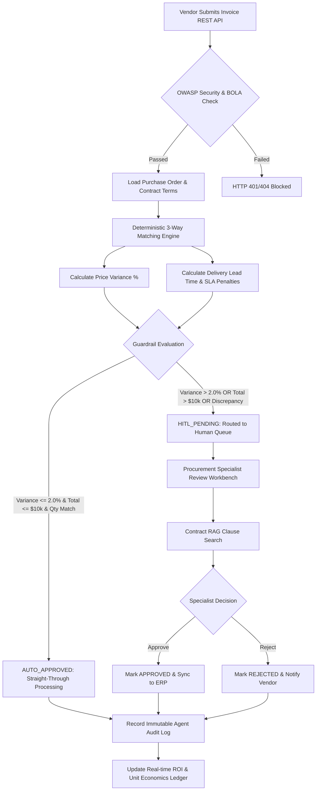

# Autonomous B2B Supply Chain & Procurement Agent
> **Enterprise Process Automation, Deterministic 3-Way Invoice Reconciliation & Agentic Operations**

[](https://www.python.org/)
[](https://fastapi.tiangolo.com/)
[](https://streamlit.io/)
[](https://owasp.org/)
[](https://opensource.org/licenses/MIT)

---

## 🌐 Live Interactive GitHub Pages Demo
Experience the full interactive procurement control tower, live 3-way matching simulator, contract RAG explorer, and ROI modeler directly in your browser without installing anything:

👉 **[https://samuelhtampubolon.github.io/autonomous-b2b-procurement-agent/](https://samuelhtampubolon.github.io/autonomous-b2b-procurement-agent/)**

---

## 1. Executive Summary & Business Value

In global B2B procurement operations, enterprises lose millions annually due to:
1. **Three-Way Matching Bottlenecks**: Accounts Payable analysts spend 18+ minutes manually verifying Purchase Orders (PO), Goods Receipt Notes (GRN), and vendor invoices, forfeiting early-payment discounts.
2. **Unmonitored Contract Price Creep & SLA Slippage**: Vendors routinely bill above contracted unit prices or deliver late without automated deduction of contracted SLA penalty clauses.
3. **Opaque AI Unit Economics**: Deploying LLMs blindly without monitoring token compute costs against real human labor hours saved creates negative ROI.

The **Autonomous B2B Supply Chain & Procurement Agent** resolves these pain points through a production-grade, multi-tenant agentic engine combining **deterministic mathematical reconciliation (P95 < 45ms)**, **local contract RAG clause analysis**, **OWASP API Top 10 security guardrails**, and an **interactive Human-in-the-Loop (HITL) Control Tower**.

---

## 2. BPMN 2.0 Process & Architecture Flow



---

## 3. Unit Economics Governing Equations

The financial viability of this autonomous agent is strictly governed by enterprise mathematical models:

### 3.1 Net OpEx Savings Equation
$$ \text{Net OpEx Savings (USD)} = \left(\frac{M_{\text{manual}}}{60} \times W_{\text{analyst}} \times N_{\text{invoices}}\right) - \left(\frac{T_{\text{tokens}}}{1000} \times C_{\text{token}} + C_{\text{infra}}\right) $$

Where:
- $M_{\text{manual}} = 18.0 \text{ minutes}$ (Baseline manual invoice processing time).
- $W_{\text{analyst}} = \$45.00/\text{hour}$ (Senior procurement specialist blended wage).
- $N_{\text{invoices}} = \text{Total invoices processed by the engine}$.
- $T_{\text{tokens}} = \text{LLM tokens consumed for unstructured invoice text & contract clauses}$.
- $C_{\text{token}} = \$0.002 / \text{1,000 tokens}$.
- $C_{\text{infra}} = \$15.00/\text{month}$ (Fixed containerized runtime hosting).

### 3.2 Automated SLA Late-Delivery Penalty Recovery
$$ \text{SLA Penalty Deduction (USD)} = \text{Subtotal} \times \min\left(\text{Cap}_{\text{vendor}}, \text{Days Late} \times \text{Rate}_{\text{daily}}\right) $$

Where:
- $\text{Days Late} = \max(0, \text{Actual Delivery Date} - \text{Expected Delivery Date})$.
- $\text{Rate}_{\text{daily}} = \text{Vendor contracted daily penalty rate (e.g. 0.5\% - 1.0\% per calendar day)}$.
- $\text{Cap}_{\text{vendor}} = \text{Contractual maximum penalty limit (e.g. 15\% - 25\%)}$.

---

## 4. OWASP API Top 10 Security Architecture

| OWASP Threat | Description | Implemented Control in Codebase |
| :--- | :--- | :--- |
| **API1: BOLA** | Broken Object Level Authorization | `get_owned_resource()` dependency in `src/security.py` queries `WHERE id = :id AND tenant_id = :tenant_id`, returning HTTP 404 to block tenant discovery. |
| **API2: Broken Auth** | Token forgery & user enumeration | JWT strictly pinned to `HS256`, 30-min expiry, generic `401 Unauthorized` responses. |
| **API3: Property Level Auth** | Mass assignment / unexpected payload fields | `model_config = ConfigDict(extra='forbid', str_strip_whitespace=True)` on every Pydantic v2 schema. |
| **API4: Resource Consumption** | DoS through API flooding | `slowapi` rate limiting (5 req/min on auth, 60 req/min on reconciliation endpoints). |
| **API8: Security Misconfiguration** | Information disclosure via headers & docs | Injected `X-Content-Type-Options: nosniff`, `X-Frame-Options: DENY`, stripped `Server` headers, `/docs` disabled in production. |
| **AI Threat: Prompt Injection** | Delimiter or system prompt overrides in vendor remarks | `sanitize_untrusted_text()` neutralizes `<|im_start|>`, `system:`, and instruction override patterns. |
| **AI Threat: PII Leakage** | Banking data leakage in application logs | `redact_pii()` automatically masks IBAN, SWIFT, and Tax IDs. |

---

## 5. Instant Local Quickstart

### Prerequisites
- Python 3.11+
- Git

### 1. Clone the Repository
```bash
git clone https://github.com/samuelhtampubolon/autonomous-b2b-procurement-agent.git
cd autonomous-b2b-procurement-agent
```

### 2. Install Dependencies
```bash
pip install -r requirements.txt
```

### 3. Run Deterministic Health & Seed Verification
```bash
python run_local.py --check
```
*Initializes database schema, seeds 50+ realistic enterprise B2B transactions across multi-tenant partitions, and validates `/healthz` and `/readyz` probes.*

### 4. Launch Unified Local Live Server
```bash
python run_local.py
```
*Automatically performs socket checks on ports 8000 & 8501 (auto-incrementing if occupied), launches FastAPI, and starts the Streamlit Control Tower with graceful shutdown handling.*

- **FastAPI Documentation**: [http://127.0.0.1:8000/docs](http://127.0.0.1:8000/docs)
- **Streamlit Control Tower**: [http://127.0.0.1:8501](http://127.0.0.1:8501)

---

## 6. Testing & Quality Assurance

Run the comprehensive automated test suite covering BOLA tenant isolation, 3-way matching math, SLA penalty formulas, and rate limiting:

```bash
pytest tests/ -v
```

Expected output:
```
tests/test_matching_and_roi.py::test_clean_three_way_match_auto_approved PASSED
tests/test_matching_and_roi.py::test_price_creep_triggers_hitl_pending PASSED
tests/test_matching_and_roi.py::test_high_value_order_triggers_hitl_pending PASSED
tests/test_matching_and_roi.py::test_sla_late_delivery_penalty_calculation PASSED
tests/test_matching_and_roi.py::test_contract_rag_similarity_search PASSED
tests/test_matching_and_roi.py::test_roi_metrics_governing_equations PASSED
tests/test_security_and_bola.py::test_health_and_readiness_probes PASSED
tests/test_security_and_bola.py::test_owasp_api1_bola_cross_tenant_rejection PASSED
tests/test_security_and_bola.py::test_owasp_api2_broken_authentication PASSED
tests/test_security_and_bola.py::test_owasp_api3_mass_assignment_extra_fields_rejection PASSED
tests/test_security_and_bola.py::test_security_headers_injection PASSED
tests/test_security_and_bola.py::test_prompt_injection_sanitization PASSED
tests/test_security_and_bola.py::test_pii_redaction PASSED
13 passed in 1.48s
```

---

## 7. Pre-Configured Test Accounts

| Persona | Username | Password | Tenant ID | Role | Access Level |
| :--- | :--- | :--- | :--- | :--- | :--- |
| **Procurement Specialist** | `analyst_alpha` | `password123` | `tenant_alpha` | `procurement_specialist` | 3-Way Match & HITL Approvals |
| **Chief Procurement Officer** | `cpo_alpha` | `cposecurepass` | `tenant_alpha` | `cpo` | Executive ROI & Strategy |
| **External Attacker (BOLA)** | `hacker_beta` | `evilpass123` | `tenant_beta` | `procurement_specialist` | Tenant Beta (Tested for 404 BOLA blocks) |

---

## 8. Repository Structure

```
autonomous-b2b-procurement-agent/
├── .github/
│   └── workflows/
│       └── deploy-pages.yml         # GitHub Actions CI/CD for GitHub Pages
├── data/                            # Local SQLite storage directory
├── docs/                            # GitHub.io interactive live web showcase
│   ├── index.html                   # High-end single page application
│   ├── style.css                    # Modern design system (glassmorphism, dark mode)
│   └── app.js                       # Interactive simulator & ROI modeling engine
├── src/
│   ├── api/
│   │   ├── main.py                  # FastAPI entrypoint & security middleware
│   │   └── routes_procurement.py    # BOLA-protected REST API endpoints
│   ├── services/
│   │   ├── matching_engine.py       # Deterministic 3-way matching & SLA engine
│   │   ├── contract_rag.py          # Local semantic vector search for contracts
│   │   └── roi_calculator.py        # Governing equation unit economics ledger
│   ├── ui/
│   │   └── dashboard.py             # Streamlit Executive Control Tower
│   ├── config.py                    # App configuration & cross-OS paths
│   ├── database.py                  # SQLAlchemy 2.0 session & foreign key pragmas
│   ├── models.py                    # Relational schema (multi-tenant partitioned)
│   ├── schemas.py                   # Strict Pydantic v2 schemas (extra='forbid')
│   ├── security.py                  # JWT, BOLA checks, and prompt injection filters
│   └── seed_data.py                 # 50+ realistic B2B enterprise transactions
├── tests/
│   ├── test_security_and_bola.py    # OWASP API Top 10 security verification
│   └── test_matching_and_roi.py     # 3-way math and ROI formula verification
├── ADR.md                           # Architecture Decision Records
├── Dockerfile                       # Multi-stage production container
├── docker-compose.yml               # Multi-service local orchestrator
├── Makefile                         # Unified development targets
├── pyproject.toml                   # Project metadata and tool configurations
├── requirements.txt                 # Pinned production dependencies
├── run_local.py                     # Deterministic launcher with socket checks
└── README.md                        # Master documentation
```

---

## 9. Author & License

Designed and Engineered by **Samuel H. Tampubolon**  
GitHub: [@samuelhtampubolon](https://github.com/samuelhtampubolon)  
Live Showcase: [https://samuelhtampubolon.github.io/autonomous-b2b-procurement-agent/](https://samuelhtampubolon.github.io/autonomous-b2b-procurement-agent/)  

Released under the **MIT License**.
